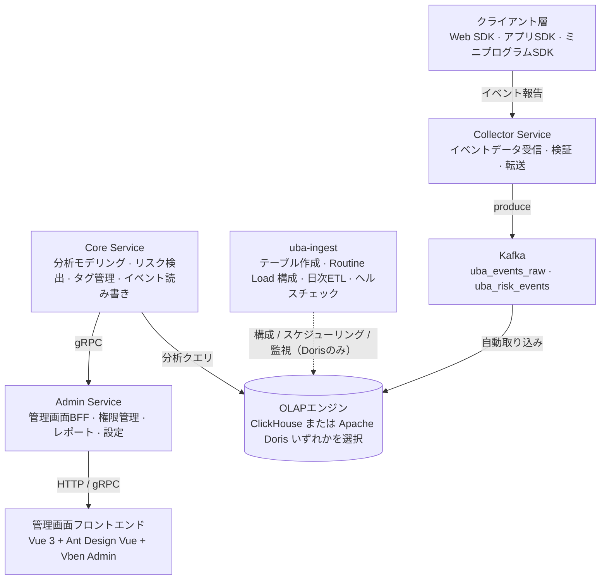

<div align="center">


# GoWind UBA · ユーザー行動分析プラットフォーム

[English](./README_en.md) | [中文](./README.md) | **日本語**

</div>

<p align="center">
  
  
  
  
  
</p>

---

## プロジェクトの特徴

- **25以上の分析モデル**：一般ユーザー行動分析（イベント/ファネル/リテンション/アトリビューション/分布/パス/セグメンテーション/クリック/属性/行動シーケンス）、ユーザー深掘りインサイト（ライフサイクル/流失と回帰/間隔時間/マトリクス/収益/セッション/異常検出/新旧比較/コンバージョンパス）、ゲーム特化（レベル分析/課金階層/LTV/サーバー別リテンション/PCU/経済システム）の3カテゴリをカバー。基礎指標から深掘りアトリビューション、ゲームバランス分析までワンストップ
- **OLAPエンジンは二択で切替**：ClickHouseとApache Dorisのいずれか一方をネイティブサポート、デプロイ時にどちらかを選択（両方の併用ではなく）、極致のクエリパフォーマンス
- **フルリンクイベント収集**：独自開発のWeb SDK、オートトラッキング（自動PV/SPAルート/滞留時間）＋カスタムイベント、オフライン再送とサンプリング/同意管理、サーバーサイドUA/IP補完、Kafka経由でリアルタイムにデータウェアハウスへ書き込み
- **インサイト→アクションの成長ループ**：永続化セグメンテーション、カスタムダッシュボード、メトリックしきい値アラート、定期レポート購読、フィーチャーフラグ/A-Bテスト、マーケティングキャンペーン、セルフサービスSQL、ユーザー360、分析から行動までワンストップ
- **AIアシスタント**：内蔵 AIチャット（ストリーミング出力＋RAGナレッジベース引用）、プラットフォーム運用ナレッジの一括同期、自然言語データ照会（自然言語→読み取り専用 SQL、テナント分離＋多層ガードレール＋データアクセス監査）、モデルプロバイダ管理とテナント月次トークン割り当てガバナンス
- **通知と可視化**：マルチチャネル通知ドメイン（社内メッセージ/メール/SMS/Webhook）＋イベントルーティングルール＋メッセージテンプレート＋配信台账；ビジュアルトラッキングでゼロコードイベント定義；rrwebセッションリプレイでユーザー操作を再生
- **マルチテナントアーキテクチャ**：テナントデータの物理的隔離、部門・ロール・管理者の自動初期化、すぐに使用可能
- **マイクロサービスアーキテクチャ**：go-kratosマイクロサービスフレームワークに基づき、サービスディスカバリ、分散トレーシング、分散キャッシュをサポート
- **リスク検出**：内蔵リスクルールエンジン、Webhookリアルタイムアラートでビジネスの安全を守る
- **プロダクションレディ**：JWT認証、Casbin/OPA認可エンジン、SSEプッシュ通知、非同期タスクスケジューリング、Swaggerドキュメント、Dockerワンクリックデプロイ

---

## UBAとは？

**UBA**（User Behavior Analytics、ユーザー行動分析）は、ウェブサイトやアプリなどのデジタルプロダクトにおけるユーザーの行動を収集・分析・報告するデータ分析技術です。企業がユーザーの嗜好、習慣、行動パターンを理解し、プロダクト体験の最適化、コンバージョン率の向上、精密なマーケティングを実現するのに役立ちます。

> UBAは最初、Eコマース分野で応用されました。クリック、お気に入り、購入などの行動を分析し、ユーザープロファイリングとターゲットマーケティング推薦を実現しました。その後、情報セキュリティ分野に導入され、多次元・長期間の相関分析と行動モデリングにより潜在的なセキュリティ脅威を発見するようになりました。

2015年、UBAは**UEBA**（User and Entity Behavior Analytics、ユーザーおよびエンティティ行動分析）に進化し、分析範囲をユーザーからデバイス、アプリケーション、エンドポイントなどのすべてのエンティティに拡大しました。機械学習と統計モデルを活用して行動ベースラインを自動的に確立し、異常行動を正確に特定します。

---

## 分析モデル

プラットフォームは25の分析モデルを提供し、一般行動分析、ユーザー深掘りインサイト、ゲーム特化の3カテゴリに分かれます。

### 一般行動分析（10）

| モデル | 典型的な質問 |
| --- | --- |
| **イベント分析** | 過去数ヶ月で、どのチャネルのユーザー登録が最も多いか？推移は？ |
| **ファネル分析** | 商品閲覧から支払いクリックまでのコンバージョンと離脱状況は？ |
| **リテンション分析** | 新規ユーザーの1日目、7日目、30日目のリテンション率は？ |
| **アトリビューション分析** | どの運用枠がユーザーを引き付け、商品を購入させたのか？ |
| **分布分析** | 個々のユーザーのプロダクトへの依存度、リピート購入率は？ |
| **ユーザーパス分析** | ユーザーはどのようにプロダクトを閲覧しているか？理想パスとの乖離は？ |
| **ユーザーセグメンテーション** | 過去30日間に商品を購入したユーザーは誰か？ターゲットマーケティング戦略は？ |
| **クリック分析** | ユーザーがクリックしたUI要素は？最も高頻度でクリックされる要素は？ヒートマップ分布は？ |
| **ユーザー属性分析** | 登録ユーザー数の推移は？都道府県別のユーザー分布は？ |
| **行動シーケンス分析** | ユーザーが支払わずに離脱。行動履歴を確認し、離脱原因を迅速に特定 |

### ユーザー深掘りインサイト（9）

| モデル | 典型的な質問 |
| --- | --- |
| **ライフサイクル** | DAUが変わらなくても、新規ユーザーは本当に定着しているか？ユーザー構造の健全性を見る |
| **流失と回帰** | ユーザーはどの段階で完全に流失するか？流失ユーザーを呼び戻す行動は何か？ |
| **間隔時間分析** | 登録から初回課金までどれくらい？2回の購入間は何日空くか？ |
| **マトリクス/象限分析** | コア機能とエッジ機能はどれか？最適化または廃止すべき機能を特定 |
| **収益分析** | ARPU/ARPPU/課金率/GMVの推移は？チャネルROI比較 |
| **セッション分析** | 平均セッション時間、直帰率、P50/P90時間、セッション深度は？ |
| **異常検出** | 昨日どのイベントのPVが急増または急落したか？計測漏れ/障害の疑いは？ |
| **新旧ユーザー比較** | 新規ユーザーの課金率と既存ユーザーの課金率の違いは？ |
| **コンバージョンパス** | 最も一般的なコンバージョンパスは？どのパスのコンバージョン率が最も高いか？ |

### ゲーム特化（6）

| モデル | 典型的な質問 |
| --- | --- |
| **レベル分析** | どのレベルの停滞率が最も高いか？離脱かコンテンツ枯渇か？数値バランスは？ |
| **課金階層** | 上位2%の大課金者は収益の何%を占めるか？パレート法則は成立するか？ |
| **LTV** | 7日/30日/90日目の累計課金価値は？どの広告チャネルのLTVが最も高いか？ |
| **サーバー別リテンション** | サーバー別のD1/D3/D7リテンションは？新旧サーバーの違いは？ |
| **PCU/ACU** | ピーク同時接続数（PCU）と平均同時接続数（ACU）は？ |
| **経済システム** | 通貨の獲得と消費のバランスは？インフレや不正取得の兆候は？ |

---

## 技術スタック

### バックエンド

| レイヤー | 技術 | 説明 |
| --- | --- | --- |
| 言語 | Go 1.25+ | 高性能コンパイル言語 |
| フレームワーク | go-kratos v2 | Bilibiliオープンソースマイクロサービスフレームワーク |
| DI | 手書きアセンブリ (`wiring.go`) | DI フレームワークなし。`make register` が登録を補助 |
| ORM | Ent | Goエンティティフレームワーク（PostgreSQL） |
| OLAPエンジン | ClickHouse / Apache Doris | カラムナストレージ、極致の分析パフォーマンス |
| メッセージキュー | Kafka | 高スループットイベントストリーム処理 |
| キャッシュ | Redis | インメモリデータベース |
| オブジェクトストレージ | MinIO | S3互換オブジェクトストレージ |
| サービスレジストリ | Etcd / Consul | サービスディスカバリと設定 |
| トレーシング | Jaeger + OpenTelemetry | 分散オブザーバビリティ |
| API定義 | Protobuf + buf.build | コントラクトファーストAPI設計 |
| 認可エンジン | Casbin / OPA | ポリシー駆動アクセス制御 |
| 非同期タスク | Asynq | Redisベースの非同期タスクキュー |
| BIプラットフォーム | Apache Superset | データ可視化とレポート |

### 管理画面フロントエンド

| 技術 | 説明 |
| --- | --- |
| Vue 3 | プログレッシブフロントエンドフレームワーク |
| TypeScript | 型安全な開発 |
| Ant Design Vue | エンタープライズUIコンポーネントライブラリ |
| Vben Admin | 管理ダッシュボードフレームワーク |
| Vite | 次世代ビルドツール |

### データ収集SDK

| SDK | 対応プラットフォーム | 説明 |
| --- | --- | --- |
| Web SDK (TypeScript) | ブラウザ / Node | Webイベント収集、自動トラッキング＋カスタムイベント、sendBeaconによるアンロード時フォールバック |
| C# SDK (.NET) | Unity（ネイティブ + WebGL）/ Godot 4 / .NET | ゲーム/クライアント計測、バッチ報告＋リトライ降格、ゼロ依存コアライブラリ |

> 導入手順については、[データ収集 SDK 導入ガイド](docs/sdk_integration.md) を参照してください。

---

## システムアーキテクチャ



> イベントの転送はGo経由ではありません：`Collector` はKafkaに書き込むだけであり、OLAPエンジン側が
> 能動的に取り込む —— Dorisは **Routine Load**、ClickHouseは **Kafkaテーブルエンジン + マテリアライズドビュー**。
> `uba-ingest` はDoris側の配線の構築と監視を担当する（下記「入倉配線を確立」参照）。

---

## コア機能

### データ収集・管理

| 機能 | 説明 |
| --- | --- |
| イベント収集 | カスタムイベント報告、Web SDKゼロコード統合 |
| オートトラッキング | 自動 page_view（SPAルート監視）、ページ滞留、クリック座標を個別実装不要で収集 |
| 信頼性のある送信 | ローカルキューの永続化（クラッシュ/オフライン後の自動再送）、セッションレベルサンプリング、プライバシー同意スイッチ |
| サーバーサイド補完 | UA解析（OS/ブラウザ/デバイスタイプ）とIP地理位置のフォールバック、クライアント値に依存しない |
| アプリケーション管理 | 収集アプリ管理、AppID/AppKey生成、収集パラメータ設定 |
| データ同期 | 同じビジネスモデルをClickHouseまたはDorisのいずれかにデプロイ可能、フィールド・パーティション・インデックス・主キーの整合性を維持 |
| セッション管理 | ユーザーセッションの自動関連付け、セッションレベルの行動分析 |

### 分析モデル

| 機能 | 説明 |
| --- | --- |
| イベント分析 | 多次元イベント統計とトレンド分析 |
| ファネル分析 | カスタムファネルステップ、コンバージョン率と離脱率の計算 |
| リテンション分析 | 新規/アクティブユーザーのリテンション、複数時間粒度対応 |
| アトリビューション分析 | マルチタッチアトリビューション、主要コンバージョンパスの特定 |
| 分布分析 | ユーザー行動頻度分布、依存度の可視化 |
| パス分析 | ユーザー行動パスの可視化、クリティカルパスの発見 |
| ユーザーセグメンテーション | 行動に基づくユーザーグルーピング、ターゲットマーケティング |
| クリック分析 | UI要素のクリックヒートマップ分析 |
| 属性分析 | 多次元ユーザー属性統計とトレンド分析 |
| 行動シーケンス | ユーザー行動タイムライン、迅速な問題特定 |
| ライフサイクル | 新規/アクティブ/定着/流失/回帰の段階分布 |
| 流失と回帰 | 静寂日数による流失判定、回帰トリガー分析 |
| 間隔時間分析 | 2イベント間の時間間隔分布 |
| マトリクス/象限分析 | 双軸4象限でコア/エッジ機能を特定 |
| 収益分析 | ARPU/ARPPU/課金率/GMV推移 |
| セッション分析 | 直帰率/時間パーセンタイル/セッション深度 |
| 異常検出 | イベント前週比変動+7日ベースライン異常警告 |
| 新旧ユーザー比較 | 新規/既存ユーザーの構成と行動・課金差異 |
| コンバージョンパス | グループパストップ+コンバージョン率 |
| レベル分析 | クリア率/停滞率/スター率/数値バランス（ゲーム） |
| 課金階層 | 大/中/小課金者階層+収益貢献度（ゲーム） |
| LTV | ライフタイムバリュー、チャネル別グループ対応（ゲーム） |
| サーバー別リテンション | サーバー別グループのリテンション（ゲーム） |
| PCU/ACU | ピークおよび平均同時接続数（ゲーム） |
| 経済システム | 通貨の獲得/消費バランス、インフレ監視（ゲーム） |

### 成長ループ

| 機能 | 説明 |
| --- | --- |
| 永続化セグメンテーション | 抽選定義の保存、定期/手動リフレッシュ、メンバードリルダウン；ファネルや抽出ページからワンクリック保存 |
| カスタムダッシュボード | 分析ウィジェット（トレンド/アクティブ/分布/ファネル/リテンション）で自由にページ構成、パラメータスナップショット保存 |
| メトリックしきい値アラート | イベント量/アクティブ/金額のしきい値監視、社内メッセージ＋Webhookのデュアルチャネル、サイレンス期間対応 |
| 定期レポート | 分析クエリを定期的に実行、概要とCSVを社内メッセージ/Webhookで配信 |
| フィーチャーフラグ/A-B | マルチバリアント＋パーミル重み＋リリース比率、一貫性ハッシュによる安定振り分け、実験結果の自動集計 |
| ユーザー360 | 行動シーケンス＋ユーザータグ＋ID マッピングの個人プロファイルページ |
| セルフサービス SQL | 読み取り専用ホワイトリスト＋行数上限＋タイムアウト制御の OLAP クエリコンソール、結果エクスポート可能 |
| ID-マッピングエンジン | ログインユーザーとデバイスの共起からクロスデバイス ID 紐付けを自動構築 |
| 動的タグ | ルール式を定期的に評価し、ユーザータグを自動書き込み |
| 通知管理 | マルチチャネル通知（社内メッセージ/メール/SMS/Webhook）、イベントルーティングルール、メッセージテンプレート、配信台账、チャネルテスト |
| マーケティングキャンペーン | セグメント × コピーライティング × 社内メッセージ一括配信、即時/定時送信、進捗トラッキング |
| ビジュアルトラッキング | ページ + 要素 XPath → イベント名、ゼロコードイベント定義、SDK自動マッチング報告 |
| セッションリプレイ | rrwebベースのユーザー操作録画、チャンク分割アップロード、管理画面プレーヤーで再生 |

### リスク・セキュリティ

| 機能 | 説明 |
| --- | --- |
| リスクルールエンジン | ビジュアルリスク検出ルール設定、多次元条件の組み合わせ |
| リスクイベント管理 | 自動リスクイベント検出、手動レビューと処理 |
| リスクイベントプッシュ | Kafka リスクイベントストリームを購読、高リスクイベントが自動的に Webhook をトリガー |
| Webhookアラート | リスク・アラートイベントのサードパーティシステムへのリアルタイムプッシュ（HMAC 署名＋リトライ＋配信ログ） |

### 組織・権限

| 機能 | 説明 |
| --- | --- |
| マルチテナント管理 | テナントデータ隔離、部門・ロール・管理者の自動初期化 |
| ユーザー管理 | ユーザーライフサイクル全体の管理、複数ロール・複数部門バインディング |
| ロール管理 | メニュー権限、API権限、データ権限のきめ細かな設定 |
| 権限管理 | 権限グループ、メニューノード、ボタンレベルのアクセス制御 |
| 辞書管理 | データ辞書カテゴリとアイテム管理、連動クエリ、ソート、インポート/エクスポート |

### システム運用

| 機能 | 説明 |
| --- | --- |
| ファイル管理 | OSSまたはローカルストレージへのアップロード、プレビュー、ダウンロード、削除 |
| キャッシュ管理 | リアルタイムキャッシュクエリ、個別または一括クリア |
| メッセージ通知 | 多レベルメッセージカテゴリ、特定ユーザーへのメッセージ送信 |
| ログインログ | ログイン成功/失敗ログ、IP、デバイス、タイムスタンプ付き |
| 操作ログ | フルチェーン操作ログ、詳細トレーシング |
| タスクスケジューリング | スケジュールタスク管理、開始/一時停止/即時実行対応 |

---

## プロジェクト構成

```
go-wind-uba/
├── backend/                            # バックエンドプロジェクト
│   ├── api/                            # Protobuf API定義と生成コード
│   │   ├── protos/                     # .protoソースファイル（ドメイン別）
│   │   │   ├── admin/                  # 管理サービスAPI
│   │   │   ├── audit/                  # 監査API
│   │   │   ├── authentication/         # 認証API
│   │   │   ├── collector/              # データ収集API
│   │   │   ├── dict/                   # 辞書API
│   │   │   ├── identity/               # アイデンティティAPI
│   │   │   ├── internal_message/       # 内部メッセージングAPI
│   │   │   ├── permission/             # 権限API
│   │   │   ├── resource/               # リソースAPI
│   │   │   ├── storage/                # ファイルストレージAPI
│   │   │   ├── task/                   # タスクAPI
│   │   │   └── uba/                    # UBAコアAPI
│   │   └── gen/go/                     # bufで生成されたGoコード
│   ├── app/                            # サービスアプリケーション
│   │   ├── admin/service/              # Adminサービス（管理画面BFF）
│   │   ├── collector/service/          # Collectorサービス（イベント収集BFF）
│   │   └── core/service/               # Coreサービス（ビジネスロジック）
│   ├── cmd/                            # 運用コマンドラインツール
│   │   └── uba-ingest/                 # 入倉配線CLI（テーブル作成 · Routine Load · 日次ETL · ヘルスチェック）
│   ├── pkg/                            # 共有パッケージ
│   │   ├── authorizer/                 # 認可エンジン
│   │   ├── constants/                  # 定数
│   │   ├── crypto/                     # 暗号化ユーティリティ（AES-GCM）
│   │   ├── dorisinit/                  # Doris入倉配線の純粋ロジック（スクリプト分割 · レンダリング · 判定）
│   │   ├── jwt/                        # JWTユーティリティ
│   │   ├── metadata/                   # メタデータ管理
│   │   ├── middleware/                 # ミドルウェア（認可/ログ/ent/メタデータ）
│   │   ├── oss/                        # オブジェクトストレージ（MinIO）
│   │   ├── serviceid/                  # サービス識別
│   │   ├── task/                       # 非同期タスク
│   │   ├── topic/                      # Kafkaトピック管理
│   │   └── utils/                      # 汎用ユーティリティ
│   ├── sql/                            # データベーススクリプト
│   │   ├── clickhouse/                 # ClickHouseスキーマ
│   │   ├── doris/                      # Dorisスキーマ（Goテンプレート、uba-ingestがレンダリング）
│   │   └── postgresql/                 # PostgreSQLスキーマ
│   ├── scripts/                        # デプロイスクリプト
│   │   ├── deploy/                     # PM2デプロイスクリプト
│   │   ├── docker/                     # Dockerデプロイスクリプト
│   │   └── env/                        # 環境セットアップスクリプト
│   └── docs/                           # ドキュメント
├── frontend/                           # フロントエンドプロジェクト
│   ├── admin/                          # 管理画面（Vue 3 + Vben Admin）
│   └── sdk/web/                        # Webデータ収集SDK
└── LICENSE                             # MITライセンス
```

---

## 📚 ドキュメントナビゲーション

| ドキュメント | 説明 | 対象読者 |
| --- | --- | --- |
| [システムアーキテクチャ](docs/architecture.md) | サービス責務、データフロー、ストレージ階層、主要設計パターン | 全体設計を理解したい人 |
| [二次開発ガイド](docs/development_guide.md) | コード生成パイプライン、サービス/エンティティ/分析集計/フロントエンドページの追加 | 二次開発者 |
| [SDK導入ガイド](docs/sdk_integration.md) | appId/appSecret取得、SDK選定、報告プロトコル、フィールド一覧 | 計測導入者 |
| [Web SDKドキュメント](frontend/sdk/web/uba/README.md) | Web SDK完全API | Web導入者 |
| [C# SDKドキュメント](sdk/csharp/README.md) | C# SDK（Unity/Godot）完全API | ゲーム/クライアント導入者 |
| [デプロイドキュメント](backend/docs/build_deploy.md) | ビルド、Dockerデプロイ | 運用 |
| [Supersetデプロイ](backend/docs/deploy_superset.md) | BI可視化プラットフォーム連携 | データ分析 |

---

## クイックスタート

### 前提条件

| ツール | バージョン |
| --- | --- |
| Go | 1.25+ |
| Node.js | >= 20.10.0 |
| pnpm | >= 9.12.0 |
| Docker | 20.0+ |
| buf | 最新版 |

### 環境セットアップスクリプト

- **Linux / macOS 開発環境**：`scripts/env/install_unix_dev.sh`
- **Linux / macOS 本番環境**：`scripts/env/install_unix_prod.sh`
- **Windows 開発環境**：`scripts/env/install_windows_dev.ps1`

### Dockerデプロイモード

- **full_deploy（完全モード）**：ミドルウェア＋バックエンドサービスを同時起動、ワンクリックデモ・本番デプロイに適しています
- **libs_only（依存のみ、開発推奨）**：ミドルウェアのみ起動、バックエンドサービスはIDEでローカル実行

### 1. 依存サービスの起動

Linux / macOS：

```bash
cd backend

# スクリプトに実行権限を付与
chmod +x scripts/**/*.sh

# ミドルウェアのみ起動（開発推奨）
./scripts/docker/libs_only.sh

# 完全デプロイ（ミドルウェア + バックエンドサービス）
./scripts/docker/full_deploy.sh
```

Windows（PowerShell 管理者）：

```powershell
cd backend

# スクリプト実行ポリシーの許可（初回のみ）
Set-ExecutionPolicy RemoteSigned -Scope CurrentUser

# ミドルウェアのみ起動（開発推奨）
.\scripts\docker\libs_only.ps1

# 完全デプロイ（ミドルウェア + バックエンドサービス）
.\scripts\docker\full_deploy.ps1
```

### 2. バックエンドサービスの起動

```bash
cd backend

# 依存関係のインストール
go mod tidy

# 開発環境の初期化（protocプラグインとCLIツールのインストール）
make init

# コード生成（ent + api + openapi）
make gen

# 全サービスのビルド
make build

# Coreサービスの起動
go run ./app/core/service/cmd/server/ -c ./app/core/service/configs

# Adminサービスの起動
go run ./app/admin/service/cmd/server/ -c ./app/admin/service/configs

# Collectorサービスの起動
go run ./app/collector/service/cmd/server/ -c ./app/collector/service/configs
```

### 3. データベースの初期化

PostgreSQL のテーブル構造は Core の初回起動時に ent が自動マイグレーションする（`app/core/service/configs/data.yaml` の
`data.database.migrate: true`）。したがって辞書のシードデータは上のステップ 2 で Core を起動した**あと**に流し込む；OLAP 側はエンジンを選択：

```bash
cd backend

# PostgreSQL（業務データベース）：辞書・初期データのみ（テーブルは自動マイグレーション）
psql -h localhost -U postgres -d gwubd -f sql/postgresql/default-data.sql

# 任意：デモデータ
psql -h localhost -U postgres -d gwubd -f sql/postgresql/demo-data.sql

# ClickHouse（分析エンジン、Doris といずれかを選択）：`uba-ingest ch-apply` での自動構成を推奨
#   （DB 作成＋全スクリプトを順に実行）；手動ではファイル名順に以下の SQL を実行
clickhouse-client --queries-file sql/clickhouse/1_base_tables.sql sql/clickhouse/02_kafka_tables.sql sql/clickhouse/03_aggregate_tables.sql sql/clickhouse/04_indexes.sql sql/clickhouse/05_views.sql

# Doris（分析エンジン、ClickHouse といずれかを選択）：スクリプトに {{...}} プレースホルダが含まれ、そのまま流し込めない → 次のステップの uba-ingest apply を参照
```

### 4. 入倉配線を確立（Doris Routine Load）

SDKから報告されたイベントはCollectorがKafkaに書き込み、**KafkaからDorisへの搬送はDoris自身の
Routine Load が担当**します。Go側でコンシューマを書かないのは意図的な設計です：スケジューリング、
並行度、再試行、オフセットはFEが管理します。構成と監視は `uba-ingest` に統一されています。

```bash
cd backend

# 入倉運用CLIをビルド
make ingest

# gw_uba のテーブルを作成し、宣言済みのRoutine Loadジョブを確実に稼働させる（冪等；--wait はDoris準備待ち）
./bin/uba-ingest -c app/core/service/configs apply --wait 5m

# 監視：ジョブ状態 / オフセット遅延 / エラーカウント；宣言済みなのに未消費 → 終了コード 1
./bin/uba-ingest -c app/core/service/configs status --json

# 日次集計の再計算（cronの代替；コンテナ構成では ingest-etl が常駐代行）
./bin/uba-ingest -c app/core/service/configs etl --loop --at 02:00

# 日中も当日データが見えるように：日中リフレッシュ（毎時間「今日」を冪等再計算；replace 系
# セクションのみ、ch-etl も --every に対応）
./bin/uba-ingest -c app/core/service/configs etl --loop --every 1h

# ClickHouse 選択時の同等操作：ch-apply でスキーマ構成、ch-etl で sessions/users 幅表の日次
# 再計算と重複排除の収束
./bin/uba-ingest -c app/core/service/configs ch-apply --wait 5m
./bin/uba-ingest -c app/core/service/configs ch-etl --loop --at 02:00
```

DSN とブローカーは `configs` または環境変数（`UBA_DORIS_DSN` / `UBA_KAFKA_BROKERS`）からのみ読み込み、
コマンドラインには渡しません。上記の構成と日次集計は Docker Compose 構成では既に配線済みです：
`ingest`（一回限りの `apply`）、`ingest-etl`（常駐スケジューラ、healthcheck は `status`）、
`ingest-etl-intraday`（日中リフレッシュ、当日を毎時間再計算）。
詳細と変更時の規約は `backend/AGENTS.md` 第6節を参照してください。

### 5. フロントエンドの起動

```bash
cd frontend/admin

# 依存関係のインストール
pnpm install

# 開発サーバーの起動
pnpm dev
```

### よく使うコマンド

```bash
cd backend

# Protobuf APIコードの生成
make api

# OpenAPIドキュメントの生成
make openapi

# TypeScriptコードの生成
make ts

# 全コード生成（ent + api + openapi）
make gen

# 全サービスのビルド
make build

# 入倉運用CLIをビルド
make ingest

# テストの実行
make test

# リント
make lint

# Docker Composeでミドルウェア起動
make docker-libs

# Docker Compose完全デプロイ
make docker-up
```

---

## バックエンドサービス

| サービス | 説明 | ポート |
| --- | --- | --- |
| **Core Service** | コアビジネスサービス。イベント保存、分析モデリング、リスク検出、タグ管理、データ同期などの主要ロジックを担当 | gRPC: 動的ポート（etcd サービスディスカバリ経由） |
| **Admin Service** | 管理画面BFF。ユーザー管理、権限管理、設定管理、レポート照会などのAPIを提供 | HTTP: 5600 / SSE: 5601 |
| **Collector Service** | イベント収集BFF。クライアントからのイベントデータを受信し、検証後にメッセージキューに転送 | HTTP: 5700 |

---

## OLAPエンジン選択とスキーマ設計

- **ClickHouseとApache Dorisは相互排他**ですが、`data.UseClickHouse` は現状 `internal/data/data.go` の**コンパイル時定数 `false`** です：ClickHouse 分岐はコンパイルから外れ、実際に動くのは Doris のみ。エンジン切替にはこの定数を変更して再ビルドが必要です。ClickHouse 側の読み取りロジックは Doris と整列済みです（イベント重複排除 / FINAL 読み / 派生表の日次再計算）：切替前に `uba-ingest ch-apply` で構成し、`ch-etl --loop` で日次再計算してください。既存環境の移行と残存する設計上の差異は `docs/architecture.md` の「OLAP 引擎二选一」節を参照
- 両エンジンは同じビジネスモデルを共有し、フィールド・パーティション・インデックス・主キー定義を一致して維持
- struct定義の自動生成、アノテーション（json、ch）の自動処理
- バッチデータ書き込み、strictモードでのNOT NULLフィールドの自動補完
- データロード後のフィールドタイプ・インデックス・パーティションの最適化は `backend/sql/` スクリプトを参照

---

## SDK統合

> 完全な導入手順（appId/appSecret 取得のためのアプリ作成、SDK 選定、上报プロトコル）は
> [データ収集 SDK 導入ガイド](docs/sdk_integration.md) を参照してください。

### Web SDK クイックスタート

```ts
import { UbaClient } from '@go-wind-uba/uba-sdk';

// 初期化（シングルトン。appId/appSecret は管理画面の「アプリケーション管理」でアプリ作成後に取得します）
const uba = UbaClient.init({
  appId: 'your_app_id',
  appSecret: 'your_app_secret',
  endpoint: 'http://localhost:5700', // collector サービスのアドレス
});

// スーパープロパティを設定（以降のすべてのイベントに自動付与）
uba.setSuperProperties({ platform: 'web', version: '1.0.0' });

// カスタムイベントのトラッキング
uba.track('page_view', { page: '/home', title: 'ホーム' });

// ログイン後にユーザーを紐付け
uba.identify(1001);
uba.track('purchase', { orderId: 'ORD-001' }, { amount: '99.90', quantity: 1 });
```

> 詳細は [Web SDK ドキュメント](frontend/sdk/web/uba/README.md) を参照してください。

### C# SDK（Unity / Godot）

```csharp
using Uba;

var client = new UbaClient(new UbaConfig {
    AppId = "your_app_id",
    AppSecret = "your_app_secret",
    Endpoint = "http://localhost:5700",
});

client.Track("scene_load", new() { ["scene"] = "Main" });
```

> Unity WebGL では `UnityWebRequestTransport` を使用してください（WebGL では HttpClient は利用できません）。
> 詳細は [C# SDK ドキュメント](sdk/csharp/README.md) を参照してください。

---

## リファレンス

- [鑄龍-BI（ユーザーイベント分析プラットフォーム）](https://www.yuque.com/jianghurenchenggolang/oehqme/hen7qy#JFdyf)
- [プロダクトマネージャーが知っておくべき AARRR モデル](https://www.woshipm.com/operate/5460612.html)
- [ユーザー行動分析と BI の違い](https://www.niutoushe.com/54408)
- [ユーザー行動分析の要点](https://www.fanruan.com/bw/zwoz)
- [ビジネスインテリジェンス（BI）とは？](https://www.sap.cn/products/technology-platform/cloud-analytics/what-is-business-intelligence-bi.html)
- [Business Intelligence in Microservices: Improving Performance](https://dzone.com/articles/business-intelligence-in-microservices-improving-p)
- [ClickHouse のリアルタイム応用と最適化](https://mp.weixin.qq.com/s/hqUCFSr8cu3x3u8HCA6WYg)
- [数百テーブルの保守から一つへ —— UEI モデル](https://zhuanlan.zhihu.com/p/623182999)

---

## 関連プロジェクト

- [go-wind-admin](https://github.com/tx7do/go-wind-admin) — すぐに使えるエンタープライズグレード管理画面スキャフォールド
- [go-wind-cms](https://github.com/tx7do/go-wind-cms) — すぐに使えるエンタープライズグレードヘッドレスコンテンツプラットフォーム

---

## お問い合わせ

- WeChat: yang_lin_bo（備考：go-wind-uba）

---

## ライセンス

このプロジェクトは [MIT License](LICENSE) の下で公開されています。

## 謝辞

[](https://jb.gg/OpenSource)

JetBrainsより無料のGoLand & WebStormオープンソースライセンスを提供していただき、感謝申し上げます。
