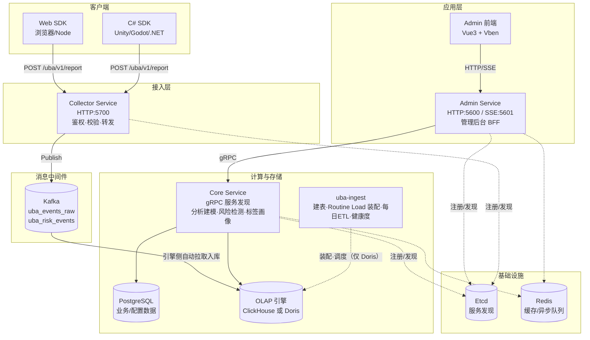

# 系统架构

本文档描述 go-wind-uba 的整体架构、服务职责、数据流转、技术选型与关键设计。

---

## 一、总体架构

go-wind-uba 是基于 **go-kratos** 微服务框架的用户行为分析（UBA）平台，采用「采集 → 入队 → 计算/存储 → 查询/展示」的经典流式数仓架构。



---

## 二、三大服务职责

### 1. Collector Service（埋点采集 BFF）

| 项 | 说明 |
|----|------|
| 端口 | HTTP **5700** |
| 职责 | 接收 SDK 上报、应用鉴权、字段校验、补全、转发至 Kafka |
| 入口 | `POST /uba/v1/report`（批量事件） |
| 鉴权 | appId + appSecret（请求体内），调用 `appAuth.Authenticate` 校验应用 |
| 输出 | `Publish` 到 Kafka topic（`uba_events_raw` / `uba_risk_events`） |
| 特点 | **无状态**，可水平扩展；本身不落库，只负责"接收 + 转发" |

### 2. Core Service（核心业务服务）

| 项 | 说明 |
|----|------|
| 端口 | gRPC **动态端口**（通过 etcd 服务发现，不固定） |
| 职责 | 事件入库、分析建模、风险检测、标签管理、用户画像、数据同步 |
| 数据源 | PostgreSQL（业务实体，走 ent ORM）+ OLAP 引擎（分析数据） |
| 对外协议 | gRPC（供 admin/collector 调用） |
| 特点 | 承载所有"重"业务逻辑；`data.UseClickHouse` 在 ClickHouse / Doris 间二选一，但它是**编译期常量 `false`**（详见「OLAP 引擎二选一」） |

### 3. Admin Service（管理后台 BFF）

| 项 | 说明 |
|----|------|
| 端口 | HTTP **5600** / SSE **5601** |
| 职责 | 管理后台的 HTTP 网关，转发请求至 core，聚合权限/菜单/配置 |
| 模式 | **薄转发层**：实现 `adminV1.XxxHTTPServer`，持有 `ubaV1.XxxClient`，方法体直接转发 |
| 特色 | SSE 推送（站内消息实时通知）、Swagger 文档、CORS |

> 三个服务均通过 **etcd** 注册与发现，跨服务调用走 gRPC。

---

## 三、数据流转

### 事件上报链路（写）

```
SDK 上报
  └─> Collector（5700）
        ├─ 1. appId/appSecret 鉴权
        ├─ 2. 字段校验 + 补全（eventId/eventTime/deviceId 等）
        ├─ 3. tenantId 权威覆盖（按 appId 识别租户）
        └─ 4. Publish → Kafka topic
              ├─ uba_events_raw   （行为事件）
              └─ uba_risk_events  （风险事件）
```

### 入仓链路：Kafka → Doris 由 Routine Load 负责（设计选择）

> 本节此前写的是"Kafka 消费入库逻辑尚未实现，上报数据会停在 Kafka"。
> **core 里没有 Kafka 消费者这句仍然成立，而且是有意的**；不成立的是"没有落库路径"——
> 搬运由 Doris 自己的 **Routine Load** 完成，Go 侧只负责装配、调度与观测。

```
Kafka topic                       Doris 侧（FE 负责调度 / 并发 / 重试 / 位点）
  uba_events_raw    ──Routine Load job_events_to_fact────>  events_fact
  uba_risk_events   ──Routine Load job_risk_events_to_fact─>  risk_events
                                    （json 直插事实表，无中间 Kafka 引擎表）
```

任务的声明在 `backend/sql/doris/02_kafka_tables.sql`（`{{.KafkaBrokerList}}` 由 `uba-ingest` 渲染），
Go 侧的三个动作都在 `backend/cmd/uba-ingest`：

| 子命令 | 职责 |
|--------|------|
| `apply` | 建库表 + 确保声明的任务在跑（幂等；`--wait` 等 Doris 就绪；默认拒绝脚本里的 STOP/DROP，因为那会丢位点） |
| `status` | 任务状态 / 位点延迟 / 错误计数；"声明了但没在消费"→ 退出码 1，可直接当 healthcheck |
| `etl` | 跑 `06_etl.sql` 的每日回算小节；`--loop --at 02:00` 常驻代管 cron |

纯逻辑（脚本切分/分类、SHOW 结果解析、apply 决策）在 `backend/pkg/dorisinit`，
细节与改动守则见 `backend/AGENTS.md` 第 6 节。

三条口径要注意：

- **ClickHouse 走的是另一套机制**：`sql/clickhouse/02_kafka_tables.sql` 用 Kafka 表引擎 +
  物化视图把同一批 topic 灌进 `events_fact` / `risk_events`，链路同样是自动的。差别在于它
  **不由 `uba-ingest` 装配**（broker 地址硬编码在脚本里，换环境要改文件），也没有 Doris 侧的
  `06_etl.sql` 每日回算 —— 依赖聚合表的分析模型在 ClickHouse 上需自行回算。
- Core 的 `BehaviorEventService.BatchCreate` 那条 gRPC 入库路径依然存在（用于补数/联调），
  但它不是主链路；主链路是上面两个 Routine Load 任务。
- `app/core/service/configs/data.yaml` 里的 `data.doris.stream_load` 段**没有任何业务代码读取**，
  属遗留配置。

### 查询链路（读）

```
Admin 前端
  └─> Admin Service（5600，HTTP）
        └─> gRPC 转发 ─> Core Service
              ├─ 业务实体 ─> PostgreSQL（ent）
              └─ 分析聚合 ─> OLAP（原生 SQL GROUP BY / ListWithPaging）
```

---

## 四、数据存储分层

| 存储 | 用途 | 访问方式 |
|------|------|---------|
| **PostgreSQL** | 业务/配置实体（应用、用户、角色、权限、字典、菜单、事件 Schema 等） | ent ORM |
| **OLAP（ClickHouse 或 Doris）** | 分析数据（events_fact / sessions_fact / risk_events 等事实表） | 原生 SQL + `go-crud` repo 封装 |
| **Redis** | 缓存、异步任务队列（Asynq） | kratos cache + asynq |
| **Kafka** | 事件流缓冲（collector → Doris 的解耦管道；消费端是 Doris Routine Load，不是 Go 服务） | kratos broker 生产 / Doris FE 拉取 |
| **MinIO** | 对象存储（文件上传） | S3 兼容 |

### OLAP 引擎二选一（现状：两引擎读数逻辑已对齐，默认仍走 Doris）

- **部署时任选其一，不叠加使用**：`data.UseClickHouse` 编译期路由决定服务连哪个引擎，运行期不会同时使用两个。
- 代码按引擎成对镜像：`internal/data/{doris,clickhouse}/` 各一份 repo + `schema/` 镜像定义，
  service 层 `if data.UseClickHouse { ckRepo } else { dorisRepo }` 分支路由。
- **但 `data.UseClickHouse` 是编译期常量而非配置项** —— `internal/data/data.go:35` 写死
  `const UseClickHouse bool = false`。因此 ClickHouse 分支被编译掉、`configs/data.yaml` 里的
  `data.clickhouse` 段并不能启用它；换引擎要改这行常量重新构建。
- ClickHouse 侧曾核实的数据正确性缺陷（已全部修复）：
  1. **无事件去重（已修）**：`events_fact` 原是普通 `MergeTree`，Kafka at-least-once 重放会重复计入
     所有 PV/UV/GMV。现改为 `ReplacingMergeTree(updated_at)`，排序键追加 `event_id` 对齐 Doris 的
     `UNIQUE KEY(event_id, tenant_id, event_time)`，并开 `optimize_on_insert=1`（整批重放在入库块内
     先去重，喂给下游物化视图的就是干净数据）；分析侧全部 SQL 带 `FINAL` 精确读取。
  2. **查询从不加 `FINAL`（已修）**：`sessions_fact`/`risk_events`/`users_dim` 等都是
     `ReplacingMergeTree`，合并前的多版本会被一起统计。现 clickhouse 仓库层 48 处手写 SQL 全部补上
     `FINAL`（含 JOIN 与子查询，语法为 `表 [AS] 别名 FINAL`）；go-crud 分页列表无法带 FINAL，
     由每日 `ch-etl` 的 `OPTIMIZE TABLE … FINAL` 强制收敛。
  3. **`users_dim`/`sessions_fact` 只有批次内局部值（已修）**：原 `mv_users_dim`/`mv_sessions_fact`
     按插入块聚合，累计值只有块内真值、跨块同会话被拆行或覆盖。现已废弃这两条 MV（05_views.sql 里的
     DROP 负责存量迁移），改为 `uba-ingest ch-etl` 按 Doris `06_etl.sql` §1/§2 同款口径做
     **全历史回算**（当天活跃集合触发 + 无时间限制全量聚合，幂等可重跑），新鲜度与 Doris 一致（按天批量）；
     `register_time`/等级等画像列与 MV 时代一样保持默认、等 core 服务经 users_dim_repo 写入。
  4. **对已合并列再次 merge（已修）**：`clickhouse/analytics_repo.go` 的 Revenue 与 Anomaly 曾对
     `events_agg_daily_view.uv` 用 `uniqCombinedMerge()`，而该视图在
     `sql/clickhouse/03_aggregate_tables.sql:514` 已经 `uniqCombinedMerge(uv) AS uv` 归约成 UInt64
     ⇒ 参数类型非法。现已改查基础表 `events_agg_daily`（状态未 merge，与 `ActiveUsers` 同一套写法），
     Revenue 也不再吞掉该查询的错误（原先置 `activeRows = nil`，ARPU/付费率会静默为 0）。
  5. **风险事件仓储的枚举转换器是 nil（已修）**：`clickhouse/risk_events_repo.go` 声明了
     `riskEventStatusConverter` 却在构造函数里从未赋值，`init()` 直接解引用；现已按 Doris 侧
     （`doris/risk_events_repo.go:39`）补上 `NewEnumTypeConverter`。
  6. **没有装配路径（已修）**：原先 `sql/clickhouse/assets.go` 的嵌入脚本在 Go 侧零引用、broker
     地址硬编码。现在 `uba-ingest ch-apply`（`pkg/clickhouseinit`）按序执行 `sql/clickhouse/InitScripts()`
     的 5 个脚本（含先建库），`02_kafka_tables.sql` 的 broker 地址已模板化为 `{{.KafkaBrokerList}}`；
     预聚合层（03_aggregate_tables.sql）漏建时，ActiveUsers/Revenue/Anomaly 会检测 UNKNOWN_TABLE
     并回退 `events_fact` 直查，不再运行时报错。
  7. **排序键与 Doris 去重键不对齐（已修）**：`risk_events` 的 ORDER BY 没有 `risk_event_id`
     （同租户同日同级别的同时刻事件会互相去重，直接丢数据）、`id_mapping` 缺 `global_user_id`
     （同一设备关联两个用户会互相覆盖）、`user_tags` 用 `effective_date`（每次刷新永久堆积新版本）。
     三者排序键均已对齐 Doris 的 UNIQUE KEY。
  8. **`02_kafka_tables.sql` 的 `toUInt16OrDefault(…, 0)` 在 CH 25.x 编译失败（已修）**：
     字面量 `0` 是 UInt8，与 UInt16 目标类型不符（Code 36）；已改为 `toUInt16OrZero(…)`。

- **存量部署迁移注意**：1_base_tables.sql 是 `CREATE IF NOT EXISTS`，老表不会自动变成新引擎/新键——
  现有 CH 部署需要重建 `events_fact`/`risk_events`/`id_mapping`/`user_tags`（旧数据不迁移的话重灌，
  或 `CREATE 新表 + INSERT SELECT FINAL`）；重跑 `ch-apply` 时 05_views.sql 的 DROP 会自动移除
  `mv_sessions_fact`/`mv_users_dim`，派生数据由 `ch-etl` 回算补齐。
- **按设计保留的口径差异**：
  - 宽表新鲜度：Doris 与 CH 都靠按天回算（Doris `etl --loop` / CH `ch-etl --loop`）。
    需要白天可见当天数据时，两引擎都有日内刷新模式：`--loop --every 1h` 每小时重算
    "今天"的 replace 语义小节（compose 里的 `ingest-etl-intraday` 服务就是 Doris 侧的
    这条）；不开启时白天查不到当天的会话/用户宽表；
  - Revenue：CH 聚合主路径（pay_agg_daily_view 存在时）只统计付费事件，Doris 统计全部
    `amount>0` 事件；CH 的聚合缺失回退路径与 Doris 同口径；
  - `path_features` 仍由 MV 按插入块生成（近似），未纳入回算。
- 已补齐的引擎间等价性（部署二选一；原先只有 Doris 可用，现在 `UseClickHouse=true` 也能工作）：
  - **风险事件消费组**：CH 的 `kafka_risk_events_raw` 原与 webhook 通知器同用 `uba_alert_sender`
    组（同一 topic 同组消费被 Kafka 均分分区，入湖与通知两边都丢数据），已改为独立的
    `uba_ingest_ch_risk`（`pkg/topic.UbaGroupIngestClickHouseRisk`）；旧部署需 DROP 重建该 Kafka 表。
  - **自助 SQL**：`clickhouse.AnalyticsRepo.ExecuteAdhocQuery`（独立 adhoc 连接 + 动态列扫描），
    `SqlQueryService` 按引擎路由，审计日志的 `data_source` 如实记录 doris/clickhouse。
  - **三个写入引擎**：TagEngine / IDMappingEngine / ImportService 原先硬编码 Doris repo，现均定义
    共用签名接口并按引擎路由；CH 侧补齐 `ListUserDevicePairs` / `SelectUsersByPredicate`。
  - **派生机制差异（按设计保留）**：Doris 的 sessions_fact/users_dim 由每晚 `06_etl.sql` 批建
    （开启 `--every` 日内刷新后白天可见当天），CH 由 05_views.sql 的 MV 实时构建；聚合表 Doris 仅 3 张且 05_views 默认不装，
    CH 11 张 + MV/视图全量装配——同一天的宽表新鲜度两边可能不同。
- **Doris 侧这条环是闭合的**：分析模型只读 `events_fact` / `users_dim` / `sessions_fact`，
  三者分别由 Routine Load 与 `06_etl.sql` §1/§2 灌数，且 `uba-ingest apply` 会装配到位点可观测。

---

## 五、关键设计模式

### 1. 接口契约优先（Protobuf）

所有服务接口由 `.proto` 定义，经 **buf** 生成多端代码：

- Go：`protoc-gen-go` + `protoc-gen-go-grpc`（gRPC stub）+ `protoc-gen-go-http`（kratos REST）
- TypeScript：`protoc-gen-typescript-http`（admin 前端客户端）
- OpenAPI：`protoc-gen-openapi`（Swagger 文档）

> 详见 [二次开发导引 - 代码生成](development_guide.md#一代码生成管线)。

### 2. 三层服务架构（admin 转发模式）

新增一个 admin 对外能力时，典型分层：

```
admin/service/v1/i_xxx.proto        # HTTP 网关接口（带 google.api.http 注解）
uba/service/v1/xxx.proto            # 领域消息 + gRPC 服务契约
core/service/internal/service/      # 业务实现（实现 uba gRPC server）
admin/service/internal/service/     # 转发实现（实现 admin HTTP server → 调 uba client）
```

admin 层是**纯转发**，不含业务逻辑；业务逻辑集中在 core。

### 3. ent + go-crud 数据层

业务实体（PostgreSQL）走 ent ORM，配合 `go-crud` 的 `Repository` 泛型封装，统一处理分页（`PagingRequest`）、过滤（`FilterExpr`）、排序、FieldMask。OLAP 数据走原生 SQL repo。

### 4. 服务发现 + 动态端口

core 服务 gRPC 监听 `0.0.0.0:0`（随机端口），启动时注册到 etcd；admin/collector 通过 etcd 发现 core 并建立 gRPC 连接。这让 core 可多实例部署、滚动更新。

---

## 六、安全与多租户

| 维度 | 机制 |
|------|------|
| 管理后台认证 | JWT（admin server，HS256） |
| SDK 上报鉴权 | appId + appSecret（应用级，请求体） |
| 权限引擎 | Casbin / OPA，菜单/接口/数据三级权限 |
| 多租户隔离 | `tenantId` 字段贯穿；SDK 不上报，服务端按 appId 权威识别并覆盖 |
| 传输 | CORS 配置；生产建议加 TLS |

---

## 七、相关文档

- [二次开发导引](development_guide.md)
- [SDK 接入指南](sdk_integration.md)
- [部署文档](../backend/docs/build_deploy.md)
- [Superset 部署](../backend/docs/deploy_superset.md)
